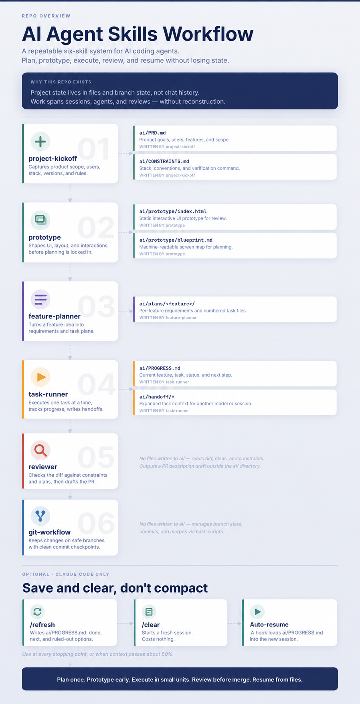

# AI Agent Skills Workflow



Six skills and a few shell scripts for building software with AI coding agents.
They work with Claude Code, Codex, OpenCode, or any agent that reads local
instruction files.

The idea is simple: project state lives in files, not in chat history. Each
skill writes what the next one needs, so work can span many sessions, and even
different AI models, without losing track.

## Quick Start

```bash
git clone https://github.com/mrlinnth/agents-skills.git && cd agents-skills
./install.sh
```

To update later, run `git pull && ./install.sh`.

`install.sh` works on macOS, Linux, WSL, and Git Bash. It installs:

| What | Where |
|---|---|
| Skills | `~/.agents/skills/` (and links `~/.claude/skills` to it, if that doesn't exist yet) |
| Scripts | `~/.local/bin/` |
| `AGENTS.md` | `~/.codex/AGENTS.md` |

Each run deletes and re-copies the skills and scripts it manages, so removed
files don't linger. It leaves other files alone. To change the folders, set
`SKILLS_DIR`, `BIN_DIR`, or `CODEX_HOME`:

```bash
SKILLS_DIR=~/my-skills BIN_DIR=~/bin ./install.sh
```

Make sure `~/.local/bin` is on your `PATH`.

> The skills carry my Laravel + React background. Change them to fit your stack.

## How It Works

Each skill writes files that the next skill reads:

```text
project-kickoff   once per project
  -> ai/PRD.md            goals, users, features, scope
  -> ai/CONSTRAINTS.md    stack, versions, conventions, test command

prototype         after kickoff, before planning
  -> ai/prototype/index.html      clickable UI prototype
  -> ai/prototype/blueprint.md    screen map for the planner

feature-planner   once per feature
  -> ai/plans/<feature>/requirements.md
  -> ai/plans/<feature>/01-*.md   numbered plan files

task-runner       builds one task at a time
  -> ai/PROGRESS.md       current state only
  -> ai/handoff/*.md      task details for another model

reviewer          after a feature is done
  -> review report + PR description (no files in ai/)

git-workflow      underneath everything
  -> branches and commits, through bash scripts
```

The planning skills also write down the options you **ruled out**, with the
reason. A later session sees "we rejected X because Y" and doesn't try X again.

## A Typical Day

**Plan** (new project or feature):

1. `project-kickoff`: answer the interview. You get `PRD.md` and `CONSTRAINTS.md`.
2. `prototype`: check the UI before you plan. Skip it if there's no UI.
3. `feature-planner`: plan each feature. You get requirements and plan files.

**Build:**

1. Say "what's next" or "resume". task-runner reads the state and picks the task.
2. It builds one task, runs its tests, marks it `[DONE]`, and commits.
3. Repeat. Start a fresh session every task or two to keep context small.

**Finish a feature:**

1. Say "review this". The reviewer checks the diff and drafts the PR text.
2. `git-workflow-end` prints a summary. You choose: PR, local merge, or leave it.

**Stop for the day:** say "snapshot". task-runner saves the state to
`ai/PROGRESS.md`. Next time, "resume" picks it up.

> **Claude Code users:** use `/refresh` then `/clear` instead of `/compact`.
> It's cheaper and keeps the ruled-out list. See
> [claude-code/README.md](claude-code/README.md).

## The Skills

### project-kickoff

**When:** once, at the start of a project or a big new planning effort.

**What it does:** interviews you about scope, users, features, stack, and how
to test. It researches current package versions, using a three-month rule: if
a new major version is less than three months old, it suggests the previous
one. It shows a summary and waits for your OK before writing.

**Writes:** `ai/PRD.md` and `ai/CONSTRAINTS.md`. CONSTRAINTS.md includes the
test command, exclusions, and the options you ruled out.

### prototype

**When:** after kickoff, before feature planning, if the product has a UI.

**What it does:** reads the PRD and any sketches, asks about brand and
navigation, then builds a single-file HTML prototype with Alpine.js and
Tailwind, screen by screen. It updates the PRD when the prototype changes the
feature list.

**Writes:** `ai/prototype/index.html` and `ai/prototype/blueprint.md` (the
screen map feature-planner reads).

### feature-planner

**When:** once per feature, and again when a plan goes stale.

**What it does:**

- **Phase 1:** interviews you about flows, edge cases, and done criteria, then
  writes `requirements.md`, including a "Ruled out" section.
- **Phase 2:** splits the work into numbered plan files.
- **Lite path** for small features: "quick plan logout: clear tokens on server
  and client, redirect to login". One confirmation, then a short requirements
  file and one plan file.
- **Replanning:** re-run Phase 2. It keeps `[DONE]` tasks and rewrites the rest
  against the current code.

**Writes:** `ai/plans/<feature>/requirements.md` and `01-*.md`, `02-*.md`, ...

### task-runner

**When:** to build from plan files, check status, stop, or resume.

**What it does:** reads the context files, finds the current task, and checks
the plan still matches the code. If the code has drifted, it stops and
suggests replanning. It builds one task, runs its tests, marks it `[DONE]`, and
commits.

| Command | Use it for |
|---|---|
| `init` | Start tracking a feature and set the first task |
| `status` | Show progress without changing files |
| `start` | Start a task and set up its branch |
| `run` | Run pending tasks in order |
| `complete` | Mark a task `[DONE]` and move on |
| `snapshot` | Save state before you stop |
| `resume` | Rebuild context from git, progress, plans, and handoffs |
| `handoff` | Write one task as small steps for another model |

**Writes:** `ai/PROGRESS.md` (latest state only, with decisions and ruled-out
options), `[DONE]` markers, `ai/handoff/*.md`, and commits.

### reviewer

**When:** after a feature is done, before merge or PR.

**What it does:** reads the diff, commits, constraints, and plans. It checks
plan and constraint compliance, code quality, and tests, then gives one report
and a verdict. It runs `qa-report` when available.

**Writes:** nothing in `ai/`. You get a review report and a PR description.

### git-workflow

**When:** under task-runner, or on its own for small tasks.

**What it does:** works only on safe branches (never `main`, `master`, or
`develop`), checks commit message prefixes, and never pushes.

- Branch types: `feature`, `fix`, `refactor`, `chore`, `docs`
- Commit prefixes: `feat:`, `fix:`, `refactor:`, `chore:`, `docs:` (a scope is
  fine, for example `feat(2.3):`)

## Helper Scripts

| Script | What it does |
|---|---|
| `git-workflow-start <type> <name>` | Prepares the repo and branch. On a protected branch it stashes tracked changes and prints a `git stash pop` hint. |
| `git-workflow-commit '<prefix>: <text>'` | Stages and commits everything |
| `git-workflow-end` | Prints diff stats, status, and next steps. Never pushes. |
| `task-status [feature]` | Read-only: git state, current progress, `[DONE]` counts, next task, open handoffs |
| `qa-report [all\|php\|js]` | Runs Pint, `artisan test`, ESLint, and the `types` and `build` npm scripts (through Sail if it's running). Prints PASS or only the failures. |
| `ai-monitor [path]` | Optional browser dashboard for a project's `ai/` folder. Needs Node.js. |

`task-status` and `qa-report` save the agent many tool calls and keep long
output out of its context. `qa-report` is built for Laravel + JS projects; on
other stacks, the skills use the plan's own test commands.

## AGENTS.md

`AGENTS.md` holds the default rules for every task: git, scope, finishing a
task, destructive actions, and what to do when a fix keeps failing. It also
has three planning rules:

- **Reuse list:** before coding, name the existing code to reuse, and what
  you checked and rejected.
- **Mechanism:** say in 1-2 sentences how the change works and what it costs.
- **Ruled out:** write rejected options down and don't retry them.

`install.sh` copies it to `~/.codex/AGENTS.md`. For Claude Code, copy or merge
it into `~/.claude/CLAUDE.md` yourself. When a skill and AGENTS.md disagree,
the skill wins for its own workflow.

**Autonomous mode:** say "run autonomously", or put `Autonomous: yes` in
`ai/CONSTRAINTS.md`, and the skills skip their confirmation steps. They write
down every assumption instead. They still stop for destructive actions,
pushes, failed tests, and plans that no longer match the code.

## Claude Code Extras

`claude-code/` has a `/refresh` command and a hook for the save-and-clear
habit. They only work in Claude Code, so `install.sh` skips them. Setup steps
are in [claude-code/README.md](claude-code/README.md).

## Reference

### The `ai/` folder

```text
your-project/
`-- ai/
    |-- PRD.md               project-kickoff
    |-- CONSTRAINTS.md       project-kickoff
    |-- PROGRESS.md          task-runner (latest state only)
    |-- prototype/
    |   |-- index.html       prototype
    |   `-- blueprint.md     prototype, read by feature-planner
    |-- plans/
    |   `-- auth/
    |       |-- requirements.md   feature-planner Phase 1
    |       |-- 01-setup.md       feature-planner Phase 2, [DONE] by task-runner
    |       `-- 02-endpoints.md
    `-- handoff/
        `-- auth-task-2.3-token-management.md   task-runner handoff
```

### Plan file format

Plan files follow a fixed shape so agents can parse them:

```markdown
# Phase 1: Setup

## Task 1.1: Database Schema

### Subtasks
- [ ] Create migration for users table
- [ ] Create migration for otp_codes table

### Key Files
- `database/migrations/2026_01_01_create_users_table.php`

### Verification
Run `php artisan migrate --pretend` and confirm no errors

---

## Task 1.2: Model Setup [DONE]
...
```

Rules:

- Task IDs are `phase.task`: `1.1`, `1.2`, `2.1`.
- Headings are `## Task N.N: Title`. Done tasks end with ` [DONE]`.
- Subtasks are concrete checkbox actions.
- Verification is a command you can run, where possible.
- State dependencies: `Depends on: Task 1.2`.
- Each task fits in one AI coding session.

### Repository layout

```text
.
|-- README.md
|-- AGENTS.md
|-- install.sh
|-- assets/            infographic
|-- claude-code/       optional Claude Code extras
|   |-- README.md
|   `-- refresh/SKILL.md
|-- skills/
|   |-- project-kickoff/SKILL.md
|   |-- prototype/SKILL.md
|   |-- feature-planner/SKILL.md
|   |-- task-runner/SKILL.md, references/HANDOFF.md
|   |-- reviewer/SKILL.md
|   `-- git-workflow/SKILL.md
`-- scripts/
    |-- git-workflow-start, git-workflow-commit, git-workflow-end
    |-- task-status, qa-report
    `-- ai-monitor
```

### Manual install

The skills are plain folders with a `SKILL.md`. Copy them where your agent
looks for skills, and the scripts onto your `PATH`:

```bash
mkdir -p ~/.agents/skills ~/.local/bin
cp -R skills/* ~/.agents/skills/
ln -s ~/.agents/skills ~/.claude/skills    # Claude Code, if you want one shared folder
cp scripts/* ~/.local/bin/ && chmod +x ~/.local/bin/{git-workflow-*,task-status,qa-report,ai-monitor}
```

## FAQ

### Do I need all six skills?

No. `git-workflow` works alone for small tasks, and task-runner can run plan
files you wrote by hand. The full pipeline pays off on projects that span many
sessions.

### What about small tasks?

Very small: use the git scripts directly.

```bash
git-workflow-start docs update-readme
# edit files
git-workflow-commit 'docs: update readme'
git-workflow-end
```

Small but worth a plan: use feature-planner's lite path ("quick plan ...").

### Does it work with models other than Claude?

Yes. The skills are Markdown, and the scripts have no AI dependency. task-runner
`handoff` writes tasks as small steps that weaker models can follow.

### What should I put in `.gitignore`?

Usually just `ai/PROGRESS.md`, because it changes all the time. Commit
`CONSTRAINTS.md`, `PRD.md`, and `plans/` so the team and agents share them.
If PROGRESS.md is ignored, `snapshot` still writes it; it just isn't committed.
That's fine for solo work.

### Why does PROGRESS.md only keep the latest state?

To save tokens. A new session needs the current state, not a diary. Finished
work is already in the `[DONE]` markers and git history. Ruled-out options are
copied forward on every snapshot, so they aren't lost.

### What if a plan goes stale?

Re-run feature-planner Phase 2 for that feature. task-runner also stops on its
own when a plan no longer matches the code.

### Does anything push or open PRs?

No. Nothing pushes without your OK. The one exception: after you approve a
local merge into `develop`, the agent pushes `develop`.

### What happens to uncommitted changes?

On `main`, `master`, or `develop`, `git-workflow-start` stashes tracked changes,
creates the branch, and prints a `git stash pop` hint. On any other branch it
stays put, leaves your changes alone, and warns you. In a brand-new repo, make
the first commit before you rely on stashing.
